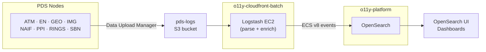

# PDS o11y-cloudfront-batch

A comprehensive web analytics system for the Planetary Data System (PDS) that processes and analyzes web access logs from multiple PDS nodes using Logstash, OpenSearch, and AWS services.

## Overview

This system ingests web access logs from various PDS nodes (ATM, EN, GEO, IMG, NAIF, PPI, RINGS, SBN) and processes them through a Logstash pipeline to extract meaningful analytics data. The processed data is stored in OpenSearch for visualization and analysis.

* [Overview](#overview)
  + [Key Features](#key-features)
* [Architecture](#architecture)
* [Prerequisites](#prerequisites)
* [Installation](#installation)
* [Package Structure](#package-structure)
* [Configuration](#configuration)
* [Usage](#usage)
  + [S3 Log Synchronization](#s3-log-synchronization-deprecated)
  + [Logstash Processing](#logstash-processing)
  + [Testing](#testing)
  + [Monitoring](#monitoring)
* [Data Processing Overview](#data-processing-overview)
  + [Supported Log Formats](#supported-log-formats)
  + [ECS Field Mapping](#ecs-field-mapping)
  + [Error Handling](#error-handling)
* [PDS Node Support](#pds-node-support)
* [Development](#development)
* [Troubleshooting](#troubleshooting)
* [License](#license)
* [Support](#support)
* [Changelog](#changelog)

### Key Features

- **Multi-format Log Processing**: Supports Apache Combined, IIS, FTP, and Tomcat log formats
- **ECS v8 Compliance**: All data is structured according to Elastic Common Schema v8
- **Comprehensive Error Handling**: Bad logs are tagged and stored separately for analysis
- **Geographic IP Resolution**: Automatic geolocation and reverse DNS lookup
- **User Agent Analysis**: Bot detection and user agent parsing
- **Test Framework**: Automated testing with sample log data
- **AWS Integration**: S3 log ingestion and OpenSearch output
- **Environment Variable Support**: Configuration via environment variables with envsubst
- **Flexible AWS Profile**: Support for AWS_PROFILE environment variable
- **Native boto3 S3 Uploads**: S3 log sync now uses boto3 (no AWS CLI required for S3 uploads)

## Architecture



PDS nodes upload access logs to a shared `pds-logs` S3 bucket using Data Upload Manager. Logstash polls S3, parses logs into ECS v8 format, and writes to OpenSearch. OpenSearch is a shared platform managed in [o11y-platform](https://github.com/NASA-PDS/o11y-platform) — both this pipeline and [o11y-cloudfront-streaming](https://github.com/NASA-PDS/o11y-cloudfront-streaming) write to it. Analysts query via OpenSearch Dashboards.

## Prerequisites

### Production deployment on AWS

See [`terraform/README.md`](terraform/README.md) for the full step-by-step deployment guide. Infrastructure runs on a PDS Cloud Oracle Linux 9 EC2 with Logstash installed via RPM and managed by systemd. Operators connect via SSH through the CDS bastion host; SSM is limited to system administrators (and developers in dev).

### Local development and testing

- **Python 3.13+** — for the s3-sync tool and unit tests
- **Docker** — for running integration tests without a local Logstash install
- **AWS credentials** — via `~/.aws/credentials`, environment variables, or IAM role
- **envsubst** — for generating Logstash pipeline configs locally (part of `gettext`)

```bash
# macOS
brew install gettext

# Amazon Linux / RHEL / CentOS
sudo dnf install gettext
```

## Installation

### 1. Clone the Repository
```bash
git clone https://github.com/NASA-PDS/o11y-cloudfront-batch.git
cd o11y-cloudfront-batch

# Create O11Y_BATCH_HOME environment variable
echo 'export O11Y_BATCH_HOME="$(pwd)"' >> ~/.bashrc
source ~/.bashrc
```

### 2. Set Up Python Environment
```bash
# Create and activate virtual environment
python3 -m venv venv
source venv/bin/activate  # On Windows: venv\Scripts\activate

# Install the package in development mode (dependencies will be installed automatically)
pip install -e .
```

**Note**: A legacy `environment.yml` file is provided for users who prefer conda, but the recommended approach is to use Python virtual environments with the package's setup.cfg configuration.

### 3. Configure Environment Variables

Copy `.env.example` to `.env` and fill in values:

```bash
cp .env.example .env
```

```ini
S3_BUCKET_NAME=your-pds-logs-bucket
S3_CF_BUCKET_NAME=               # CloudFront logs bucket (EN only); leave empty to skip
OPENSEARCH_URL=https://your-opensearch-domain.us-west-2.es.amazonaws.com
INDEX_PREFIX=pds-weblogs
AWS_REGION=us-west-2
```

Then source it before running scripts locally:

```bash
set -a; source .env; set +a
```

### 4. Build Logstash Pipeline Configs (local only)

On the EC2, `logstash-deploy.sh` does this automatically. For local dev:

```bash
set -a; source .env; set +a
LS_SETTINGS_DIR=$(pwd)/config/logstash/config ./scripts/logstash_build_config.sh
```

This generates `config/logstash/config/pipelines.yml` and one `.conf` file per PDS node under `config/logstash/config/pipelines/`.

To build only a subset of nodes (e.g. to let one node's S3 backlog catch up
before enabling the rest), set `ENABLED_NODES` to a comma/space-separated,
case-insensitive list of node IDs:

```bash
ENABLED_NODES=en LS_SETTINGS_DIR=$(pwd)/config/logstash/config ./scripts/logstash_build_config.sh
```

Leaving `ENABLED_NODES` unset (the default) builds all nodes, as above. See
[Deploying with a subset of nodes](docs/operations.md#deploying-with-a-subset-of-nodes)
for the full staged-rollout workflow.

#### 5. Apply the OpenSearch Index Template (manual/one-time)

On the EC2, `logstash-deploy.sh` applies this automatically via the AWS CLI. To apply manually from the OpenSearch Dev Console:

```
GET _cat/templates
PUT _index_template/pds-o11y-cloudfront-batch
# paste config/opensearch/ecs-8.17-custom-template.json
GET _cat/templates
```

## Package Structure

The PDS Web Analytics system is organized as a Python package:

```
src/pds/o11y_batch/
├── __init__.py          # Package initialization
├── s3_sync.py          # S3Sync class implementation (now uses boto3)
└── VERSION.txt         # Package version
```

### Installing the Package

After setting up the environment, install the package in development mode:

```bash
cd $O11Y_BATCH_HOME

# Install in development mode
pip install -e .

# Verify installation
s3-log-sync --help
```

This makes the `s3-log-sync` command available system-wide.

## Configuration

### Logstash Configuration Structure

```
config/logstash/config/
├── inputs/                    # S3 input configurations for each PDS node
│   ├── pds-input-s3-atm.conf
│   ├── pds-input-s3-en.conf
│   ├── pds-input-s3-geo.conf
│   ├── pds-input-s3-img.conf
│   ├── pds-input-s3-naif.conf
│   ├── pds-input-s3-ppi.conf
│   ├── pds-input-s3-rings.conf
│   └── pds-input-s3-sbn.conf
├── shared/                    # Shared filter and output configurations
│   ├── pds-filter.conf       # Main processing pipeline
│   └── pds-output-opensearch.conf
├── plugins/                   # Custom plugins and patterns
│   └── regexes.yaml           # User-agent regex patterns from https://github.com/ua-parser/uap-core — update periodically
├── logstash.yml              # Logstash main configuration
└── pipelines.yml.template    # Pipeline definitions
```

### S3 Log Sync Configuration

Create a configuration file based on `config/config_example.yaml`:

```yaml
s3_bucket: ${S3_BUCKET}
s3_subdir: logs
subdirs:
  data:
    logs:
      include:
        - "*"
```

The configuration supports environment variable substitution using `${VARIABLE_NAME}` syntax, which is processed by `envsubst` (still required).

## Usage

### S3 Log Synchronization (deprecated)

**NOTE:** This script has been deprecated from use. See Data Upload Manager for pushing logs.

**NOTE:** This step below is NOT required to be performed if you already have files in S3.

Sync logs from PDS reporting servers to S3:

```bash
cd $O11Y_BATCH_HOME

# Using the package command (recommended)
s3-log-sync -c config/config.yaml -d /var/log/pds

# If AWS_PROFILE environment variable is set, it will be used automatically
export AWS_PROFILE=pds-analytics
s3-log-sync -c config/config.yaml -d /var/log/pds

# Or explicitly specify the AWS profile
s3-log-sync -c config/config.yaml -d /var/log/pds --aws-profile pds-analytics

# Disable gzip compression
s3-log-sync -c config/config.yaml -d /var/log/pds --no-gzip

# Set up as a cron job (example: every hour)
0 * * * * cd /path/to/o11y-cloudfront-batch && s3-log-sync -c config/config.yaml -d /var/log/pds
```

**Note**: The `--aws-profile` argument defaults to the `AWS_PROFILE` environment variable if it's set. If neither is provided, the command will fail with a helpful error message. All S3 uploads are performed using boto3 (not the AWS CLI).

### Logstash Processing

In production, Logstash runs as a `systemd --user` service under the shared `pdsops`
key-user account on a PDS Cloud EC2, reached through the CDS bastion host. Deploying,
subset-of-nodes rollouts, the egress report, and re-ingesting S3 history are covered in
the [Operations Runbook](docs/operations.md). To connect, see the
[Access model](terraform/logstash/README.md#access-model); to check a deployment, see
[Verify the deployment](terraform/logstash/README.md#verify-the-deployment).

### Testing

The pipeline integration tests run in Docker (`docker compose run --rm test`). How to run them, read their output, and add tests for a new log format is in [`tests/README.md`](tests/README.md).

### Monitoring

Service status, logs, pipeline stats, and OpenSearch document counts are covered in the
[Operations Runbook](docs/operations.md#monitoring).

## Data Processing Overview

### Supported Log Formats

1. **Apache Combined Log Format**
   ```
   192.168.1.1 - - [25/Dec/2023:10:30:45 +0000] "GET /data/file.txt HTTP/1.1" 200 1024 "http://referrer.com" "Mozilla/5.0..."
   ```

2. **Microsoft IIS Log Format**
   ```
   2023-12-25 10:30:45 W3SVC1 192.168.1.1 GET /data/file.txt 80 - 192.168.1.100 Mozilla/5.0... 200 0 0 1024 0 15
   ```

3. **FTP Transfer Logs**
   ```
   Mon Dec 25 10:30:45 2023 1 192.168.1.1 1024 /data/file.txt a _ o r user ftp 0 * c
   ```

4. **Tomcat Access Logs**
   ```
   192.168.1.1 - - [25/Dec/2023:10:30:45 +0000] "GET /webapp/data HTTP/1.1" 200 1024
   ```

### ECS Field Mapping

The system maps log data to Elastic Common Schema v8 fields (among others):

- `[source][address]` - Client IP address
- `[url][path]` - Requested URL path
- `[http][request][method]` - HTTP method (GET, POST, etc.)
- `[http][response][status_code]` - HTTP status code
- `[http][response][body][bytes]` - Response size in bytes
- `[user_agent][original]` - User agent string
- `[event][start]` - Request timestamp
- `[organization][name]` - PDS node identifier

### Error Handling

The system handles various error conditions:

- **Bad Unicode**: Logs with invalid characters are tagged with `bad_log`
- **Parse Failures**: Unparseable logs are tagged with `_grok_parse_failure`
- **Invalid HTTP Methods**: Non-standard methods are tagged with `_invalid_http_method`
- **Missing Fields**: Logs missing required fields are tagged appropriately

All error logs are stored in `/tmp/bad_logs_YYYY-MM.txt` with detailed error information.

## PDS Node Support

The system processes logs from the following PDS nodes:

| Node | Domain | Protocol | Dataset |
|------|--------|----------|---------|
| ATM | pds-atmospheres.nmsu.edu | HTTP/FTP | atm.http, atm.ftp |
| EN | pds.nasa.gov | HTTP | en.http |
| GEO | Multiple domains | HTTP/FTP | geo.http, geo.ftp |
| IMG | pds-imaging.jpl.nasa.gov | HTTP | img.http |
| NAIF | naif.jpl.nasa.gov | HTTP/FTP | naif.http, naif.ftp |
| PPI | pds-ppi.igpp.ucla.edu | HTTP | ppi.http |
| RINGS | pds-rings.seti.org | HTTP | rings.http |
| SBN | Multiple domains | HTTP | sbn.http |

## Development

### Project Structure

```
o11y-cloudfront-batch/
├── config/                    # Configuration files
│   ├── logstash/             # Logstash configurations
│   └── config_example.yaml   # S3 sync configuration template
├── scripts/                   # Utility scripts
│   ├── s3_log_sync.py        # S3 log synchronization
│   └── img_s3_download.py    # Image data download
├── tests/                     # Test framework
│   ├── data/logs/            # Sample log files
│   ├── config/               # Test configurations
│   └── run_tests.sh          # Test runner
├── docs/                      # Documentation
├── terraform/                 # Infrastructure as Code
└── src/                       # Source code
```

### Installation

Install in editable mode and with extra developer dependencies into your virtual environment of choice:

    pip install --editable '.[dev]'

See [the wiki entry on Secrets](https://github.com/NASA-PDS/nasa-pds.github.io/wiki/Git-and-Github-Guide#detect-secrets) to install and setup detect-secrets.

Then, configure the `pre-commit` hooks:

    pre-commit install
    pre-commit install -t pre-push
    pre-commit install -t prepare-commit-msg
    pre-commit install -t commit-msg

These hooks then will check for any future commits that might contain secrets. They also check code formatting, PEP8 compliance, type hints, etc.

👉 **Note:** A one time setup is required both to support `detect-secrets` and in your global Git configuration. See [the wiki entry on Secrets](https://github.com/NASA-PDS/nasa-pds.github.io/wiki/Git-and-Github-Guide#detect-secrets) to learn how.

### Adding New PDS Nodes

1. Create a new input configuration in `config/logstash/config/inputs/`
2. Add the node to `config/logstash/config/pipelines.yml.template`
3. Update the S3 sync configuration
4. Add integration tests — see [Adding Tests for New Log Formats](tests/README.md#adding-tests-for-new-log-formats)
5. Update this README with node information

### Contributing

1. Fork the repository
2. Create a feature branch
3. Make your changes
4. Add tests for new functionality
5. Run the test suite
6. Submit a pull request

## Troubleshooting

Common failures (Logstash will not start, no data in OpenSearch, empty `S3_CF_BUCKET_NAME`),
log locations, and tuning are covered in the [Operations Runbook](docs/operations.md#troubleshooting).

## License

This project is licensed under the Apache License 2.0 - see the [LICENSE.md](LICENSE.md) file for details.

## Support

For questions and support:
- Check the [PDS Web Analytics PDF](PDS%20Web%20Analytics%20with%20Logstash%20_97cf55c410a64bbc903a13347b02ea71-260625-0752-1596.pdf) for detailed technical information
- Review the test framework for usage examples
- Contact the PDS development team

## Changelog

See [CHANGELOG.md](CHANGELOG.md) for a detailed history of changes and improvements.
