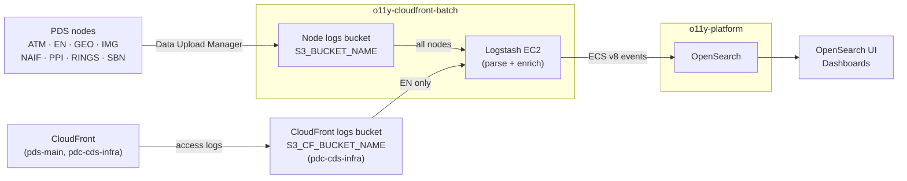

# PDS o11y-cloudfront-batch

Batch web analytics for the Planetary Data System (PDS). Logstash reads access logs from S3, parses them to Elastic Common Schema (ECS) v8, enriches them (GeoIP, reverse DNS, user agent), and writes them to OpenSearch.

* [Architecture](#architecture)
* [Documentation map](#documentation-map)
* [Local development](#local-development)
* [Configuration](#configuration)
* [Data processing](#data-processing)
* [PDS nodes](#pds-nodes)
* [S3 log sync (deprecated)](#s3-log-sync-deprecated)
* [Development](#development)

## Architecture



PDS nodes upload access logs to the node logs bucket, one prefix per node, using Data Upload Manager. CloudFront access logs for EN arrive in the CloudFront logs bucket. One Logstash pipeline per node polls its prefixes and writes to monthly `${INDEX_PREFIX}-YYYY-MM` indices. OpenSearch is a shared platform in [o11y-platform](https://github.com/NASA-PDS/o11y-platform); [o11y-cloudfront-streaming](https://github.com/NASA-PDS/o11y-cloudfront-streaming) writes to it too.

## Documentation map

Each topic has one home; other docs link to it.

| Topic | Home |
|---|---|
| Deployment order, permission tiers, SSM contract, teardown | o11y-platform [deployment runbook](https://github.com/NASA-PDS/o11y-platform/blob/main/terraform/README.md) |
| This repo's `iam`, `s3`, `logstash` modules and updates | [`terraform/README.md`](terraform/README.md) |
| Connect to the EC2 (bastion, `pdsops`), first-boot setup, verify | [`terraform/logstash/README.md`](terraform/logstash/README.md) |
| Deploy, subset-of-nodes rollout, monitoring, troubleshooting, tuning | [Operations Runbook](docs/operations.md) |
| Pipeline integration tests, adding a log format | [`tests/README.md`](tests/README.md) |
| OpenSearch index template | [`config/opensearch/README.md`](config/opensearch/README.md) |
| Bastion host, SSH key enrollment | pdc-cds-infra [bastion-core](https://github.com/NASA-PDS/pdc-cds-infra/blob/main/terraform/bastion-core/README.md) |
| CloudFront distribution and the o11y flags | pdc-cds-infra [`pds-main`](https://github.com/NASA-PDS/pdc-cds-infra/blob/main/terraform/cloudfront/pds-main/README.md#o11y-integration) |

## Local development

Production runs on a PDS Cloud EC2; see the map above. Locally you can build the pipeline configs and run the integration tests.

**Prerequisites:** Python 3.12+, Docker (integration tests), `envsubst` (`brew install gettext` on macOS, `sudo dnf install gettext` on RHEL), and AWS credentials for anything that touches AWS.

```bash
git clone https://github.com/NASA-PDS/o11y-cloudfront-batch.git
cd o11y-cloudfront-batch
python3 -m venv venv
source venv/bin/activate
pip install -e '.[dev]'
```

Run the tests:

```bash
docker compose run --rm test
```

Build the pipeline configs from `.env` (copy `.env.example` first and fill in the values below):

```bash
set -a; source .env; set +a
LS_SETTINGS_DIR=$(pwd)/config/logstash/config ./scripts/logstash_build_config.sh
```

This generates `pipelines.yml` and one `pipelines/pipeline-pds-input-s3-<node>.conf` per node (input + filter + output). Set `ENABLED_NODES` (see [subset-of-nodes rollout](docs/operations.md#deploying-with-a-subset-of-nodes)) to build only some nodes. On the EC2, `logstash-deploy.sh` does all of this.

## Configuration

| Variable | Purpose |
|---|---|
| `S3_BUCKET_NAME` | Node logs bucket |
| `S3_CF_BUCKET_NAME` | CloudFront logs bucket (EN only). Required whenever EN is enabled: if empty, the EN CloudFront inputs fail at runtime ([Troubleshooting](docs/operations.md#troubleshooting)) |
| `OPENSEARCH_URL` | OpenSearch endpoint URL |
| `INDEX_PREFIX` | Index prefix (default `pds-weblogs`) |
| `AWS_REGION` | AWS region |

On the EC2 these are in `/etc/logstash/env` ([Deployed files](docs/operations.md#deployed-files)).

```
config/logstash/config/
├── inputs/                 # one pds-input-s3-<node>.conf per node: prefixes, poll interval, dataset metadata
├── shared/
│   ├── pds-filter.conf     # parsing, ECS mapping, enrichment
│   └── pds-output-opensearch.conf
├── plugins/regexes.yaml    # user-agent patterns from uap-core (see the runbook to refresh)
├── logstash.yml            # defaults for all pipelines
├── jvm.options
└── pipelines.yml.template  # per-pipeline settings
```

## Data processing

**Log formats:** Apache Combined, Microsoft IIS, FTP transfer (xferlog), Tomcat access, and CloudFront (JSON and legacy W3C).

**Key ECS fields:**

| Field | Content |
|---|---|
| `source.address` | Client IP |
| `url.path` | Request path |
| `url.path_parts` | Path segments, e.g. `["pds", "data", "LUCY"]`; filter by mission anywhere in the path |
| `url.query_params` | Query string as an object, e.g. `url.query_params.target: "lucy"` |
| `url.query_parts` | `"key=value"` strings, e.g. `url.query_parts: "*lucy*"` |
| `http.request.method`, `http.response.status_code`, `http.response.body.bytes` | Request details |
| `user_agent.original` | User agent string |
| `event.start` | Request timestamp |
| `organization.name` | Node ID (set by the input) |
| `event.dataset` | Source, e.g. `en.http`, `naif.ftp` |

**Bad logs:** events with certain failure tags go to `/tmp/bad_logs_YYYY-MM.txt` on the EC2 instead of OpenSearch. See [Bad logs](docs/operations.md#bad-logs).

## PDS nodes

Each node has one pipeline, built from `inputs/pds-input-s3-<node>.conf`.

| Node | S3 prefix (node logs bucket) | Domains | `event.dataset` |
|---|---|---|---|
| ATM | `atm/` | pds-atmospheres.nmsu.edu | `atm.http`, `atm.ftp` |
| EN | `en/`; CloudFront bucket: `pdc-cds-infra/cloudfront/access/{json,w3c}/pds-main/`, `.../w3c/portal-legacy/` | pds.nasa.gov, pds.mcp.nasa.gov | `en.http`, `en.cloudfront.main`, `en.cloudfront.legacy` |
| GEO | `geo/` | pds-geosciences.wustl.edu, an.rsl.wustl.edu, ode.rsl.wustl.edu, pds-speclib.rsl.wustl.edu | `geo.http`, `geo.ftp` |
| IMG | `img/` | pds-imaging.jpl.nasa.gov | `img.http` |
| NAIF | `naif/` | naif.jpl.nasa.gov, pds-naif.jpl.nasa.gov | `naif.http`, `naif.ftp` |
| PPI | `ppi/` | pds-ppi.igpp.ucla.edu | `ppi.http` |
| RINGS | `rings/` | pds-rings.seti.org, opus.pds-rings.seti.org | `rings.http` |
| SBN | `sbn/` | sbn.psi.edu, sbnapps.psi.edu, pds-smallbodies.astro.umd.edu | `sbn.http` |

EN polls every 15 minutes; the other nodes every 2 hours.

## S3 log sync (deprecated)

`s3-log-sync` uploads local log files to S3 (gzip by default, via boto3). Nodes now use Data Upload Manager; the tool is kept for reference. Config template: `config/config_example.yaml`.

```bash
s3-log-sync -c config/config_example.yaml -d /var/log/pds --aws-profile "${AWS_PROFILE}"
```

Options: `--no-gzip` to skip compression, `--force` to upload files that already exist in S3. `--aws-profile` defaults to `AWS_PROFILE`.

## Development

Install the pre-commit hooks (formatting, linting, type hints, secrets detection). The secrets hook needs a one-time setup: see the [wiki entry on Secrets](https://github.com/NASA-PDS/nasa-pds.github.io/wiki/Git-and-Github-Guide#detect-secrets).

```bash
pre-commit install
pre-commit install -t pre-push
pre-commit install -t prepare-commit-msg
pre-commit install -t commit-msg
```

Before pushing without the hooks, run `tox`.

**Adding a PDS node:**

1. Add `config/logstash/config/inputs/pds-input-s3-<node>.conf` with the S3 prefixes and the `[organization][name]`, `[url][domain]`, and `[event][dataset]` fields.
2. Add the node to `config/logstash/config/pipelines.yml.template`.
3. Add integration tests ([Adding tests for a new log format](tests/README.md#adding-tests-for-a-new-log-format)).
4. Add the node to the table above and to the `ENABLED_NODES` list in the [runbook](docs/operations.md#deploying-with-a-subset-of-nodes).

## License

Apache License 2.0; see [LICENSE.md](LICENSE.md). Release history is in [CHANGELOG.md](CHANGELOG.md).
